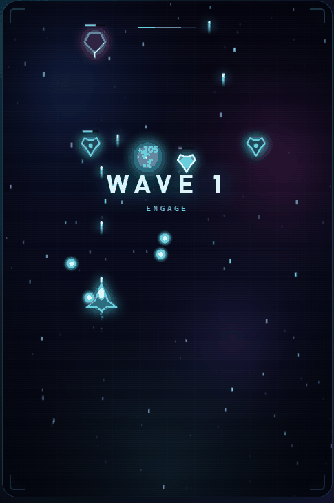
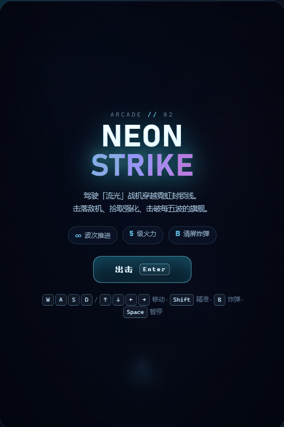
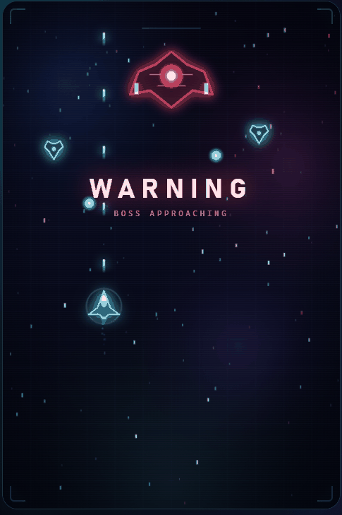

# NEON STRIKE · 霓虹空战

一款**零依赖**的竖版弹幕射击游戏：原生 JavaScript + Canvas 2D + WebAudio，无框架、无构建步骤、无外部素材。
打开 `index.html` 即可游玩。



<p align="center">
  
  
</p>

## 玩法

驾驶「流光」战机守住封锁线，击落一波又一波的敌机。每清空一波都会获得额外奖励，**每五波**会出现一艘三段形态的旗舰。

| 操作 | 按键 |
| --- | --- |
| 移动 | `W` `A` `S` `D` 或 `↑` `↓` `←` `→` |
| 精准模式（减速 + 弹道收束） | 按住 `Shift` |
| 清屏炸弹 | `B` |
| 暂停 / 继续 | `Space` 或 `Esc` |
| 静音切换 | `M` |
| 开始 / 重开 | `Enter` |

移动端：直接在棋盘上拖动即可操控战机，松手即停；炸弹按钮位于画面下方。

## 内容

- **5 种敌机**：侦察机（俯冲点射）、织网者（横向摆动双发）、狙击手（悬停三连速射）、堡垒机（环形弹幕）、旗舰（扇形弹幕 / 瞄准散射 / 旋转螺旋三段形态）。
- **火力成长**：1–5 级武器，弹道从单发逐步扩展到五路扇形；满级后拾取火力道具转化为分数。
- **道具系统**：`P` 火力强化、`+` 护盾（最多 5 格）、`B` 炸弹补充，靠近时会被战机吸附。
- **连击倍率**：连续击落可叠加得分倍率（最高 +100%），2.6 秒内没有新击落则重置。
- **程序化音效**：射击、爆炸、拾取、警报全部由振荡器与噪声实时合成，没有任何音频文件。
- **手感细节**：屏幕震动、命中闪白、爆炸粒子、冲击波、飘分文字、扫描线、视差星域。

## 运行

```bash
# 方式一：直接打开
start index.html        # Windows
open index.html         # macOS

# 方式二：本地静态服务器（推荐，模块加载更稳定）
npm start               # → http://127.0.0.1:4173/
```

只需要 Node.js 18+ 用于本地服务器，游戏本身不需要任何运行时依赖。

## 测试

游戏核心（`js/core.js`）是纯逻辑、可复现的：不触碰 DOM、不使用 `Math.random`、不依赖计时器。
因此可以在 Node 里用固定种子和固定步长完整模拟一局。

```bash
npm test
```

23 个用例覆盖：移动与边界、精准模式、指针操控、命中判定、无敌帧、护盾耗尽、炸弹、道具、波次推进、旗舰形态切换、连击倍率、暂停、确定性重放、长时间运行稳定性。

## 结构

```
index.html            页面骨架与界面文案
css/style.css         霓虹主题、响应式布局与动效
js/core.js            确定性游戏核心（实体、碰撞、波次导演）
js/render.js          Canvas 渲染层（只读 state）
js/audio.js           WebAudio 合成器
js/game.js            外壳：输入、固定步长循环、HUD、界面状态机
scripts/serve.mjs     零依赖静态服务器
tests/core.test.mjs   node:test 单元测试
```

核心以固定步长（1/60 秒）推进，渲染层按屏幕实际帧率绘制，因此逻辑结果与设备性能无关。

## 设计取舍

- **逻辑与渲染分离**：`core.js` 完全可测；`render.js` 只读取状态。加新敌人只需改两处。
- **固定步长 + 累积器**：慢设备上不会因为掉帧而让弹幕穿过战机；单帧最多补 5 步以避免追帧雪崩。
- **无素材**：所有图形由 Canvas 路径绘制，所有音效由 WebAudio 合成，仓库里只有代码和截图。
- **可复现**：随机数使用 mulberry32，同一 seed + 同一输入必然得到同一局。

## License

[MIT](LICENSE)
